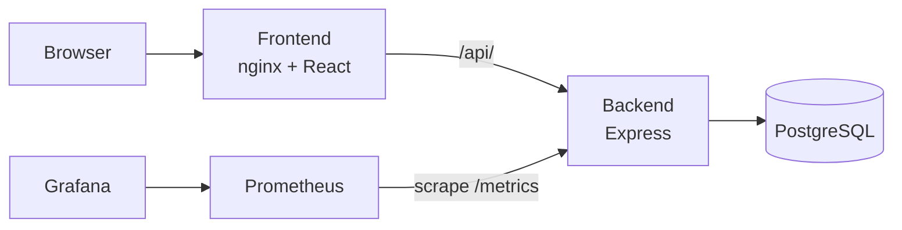

# Service Health & Incident Dashboard

A small full-stack app for tracking service status and incidents, built as a **DevOps / SRE portfolio project**. The app is deliberately simple. The point is the workflow around it: containers, CI/CD, Kubernetes, health probes, rollback, monitoring and alerting.

## What it does

- Register services (name, status) and log incidents against them
- Backend exposes liveness (`/health`) and readiness (`/ready`) endpoints and Prometheus metrics (`/metrics`)
- React frontend served by nginx, which proxies `/api/` to the backend

## Architecture



### Network design (Docker Compose)

| Network | Members | Purpose |
|---|---|---|
| `frontend-net` | frontend, backend | Browser-facing traffic |
| `backend-net` | backend, postgres | Database is **not** reachable from the frontend |

Ports are bound to `127.0.0.1` only.

## Tech stack

Node.js 22 / Express / `pg` · React (Vite) · PostgreSQL · Docker & Compose · GitHub Actions · Trivy · GHCR · Kubernetes (Minikube) · Prometheus · Grafana

## Repository layout

```
backend/            Express API, Dockerfile, Jest tests
frontend/           Vite React app, nginx.conf, Dockerfile
database/init.sql   Schema (services, incidents)
docker-compose.yml  Local stack
k8s/                Namespace, ConfigMap, PVC, Deployments, Services
k8s/monitoring/     Prometheus, Grafana, dashboard, alert rules
.github/workflows/  CI pipeline
RUNBOOK.md          Operations guide
```

## Quick start (Docker Compose)

```bash
cp .env.example .env        # then set a real DB password
docker compose up -d --build
curl localhost:3001/health
# UI: http://localhost:8080
```

## Tests

```bash
cd backend && npm ci && npm test   # 11 tests, DB mocked
```

## Kubernetes (Minikube)

Secrets are created by command and are **not** in the repo.

```bash
minikube start
kubectl apply -f k8s/namespace.yaml
kubectl -n shid create secret generic db-credentials \
  --from-literal=POSTGRES_DB=<db-name> \
  --from-literal=POSTGRES_USER=<db-user> \
  --from-literal=POSTGRES_PASSWORD='<your-password>'
kubectl -n shid create configmap db-init --from-file=database/init.sql
kubectl apply -f k8s/
kubectl -n shid wait --for=condition=ready pod --all --timeout=240s
kubectl -n shid port-forward svc/frontend 8080:80
```

### Probes

| Probe | Endpoint | Checks DB? | On failure |
|---|---|---|---|
| Liveness | `/health` | No | Container restarted |
| Readiness | `/ready` | Yes (`SELECT 1`) | Removed from Service, returns 503 |

Keeping liveness DB-free avoids restart storms when the database is down.

## CI/CD (GitHub Actions)

1. **backend-tests**: install and run Jest
2. **build-scan-push** (matrix: backend, frontend): build image, **Trivy scan (fails on CRITICAL, unfixed ignored)**, then on `main` push to GHCR tagged with the full commit SHA

The runner is pinned to `ubuntu-24.04`.

## Monitoring

- Backend records `http_request_duration_seconds` (histogram by method, route, status)
- Prometheus discovers backend pods and scrapes `/metrics`
- Grafana is provisioned with a datasource and a 4-panel backend dashboard
- Alert rule `BackendNotReady` fires when `/ready` returns 503 for 1 minute

## Failure testing

| Test | Result |
|---|---|
| Postgres scaled to 0 | Backends go `0/1` (not ready), **restart count unchanged**, frontend stays up, `BackendNotReady` fires |
| Bad image rolled out | Rolling update stalls, old pods keep serving; `kubectl rollout undo` restores |
| Pod deleted | Replacement scheduled automatically |
| Postgres pod deleted | Data survives (PVC) |

## Security notes

- Backend container runs as non-root (`USER node`)
- Dependencies audited (`npm audit --omit=dev`); transitive fix via `overrides`
- Kubernetes Secrets are only base64-encoded, not encrypted
- `.env` is git-ignored; no credentials in the repo

## Screenshots

Add to `docs/screenshots/`: Grafana dashboard, CI run history, GHCR packages, stalled bad rollout, Grafana during outage, Jira board.

## Lessons learned

- A DB outage crashed the backend until an idle-client `pool.on('error')` handler was added. Only a real outage test revealed it.
- Liveness and readiness must answer different questions.
- Test data persistence only after the DB is actually ready (`kubectl wait`).
- Guessing a third-party Action tag broke CI; pinning to a known-good approach (Trivy image) fixed it.

## Known limitations

- The stock nginx frontend master process runs as root (`nginx-unprivileged` would fix this)
- `/api/metrics` is reachable through the frontend proxy and should be blocked
- Trivy gate is CRITICAL-only
- No Ingress, Alertmanager, or automated deploy stage yet
- Single Postgres replica, local Minikube only
